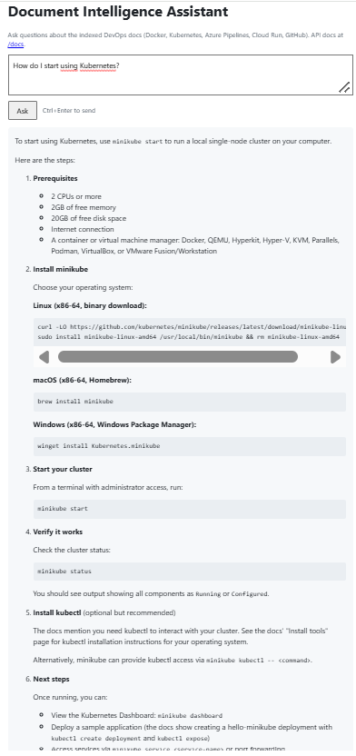
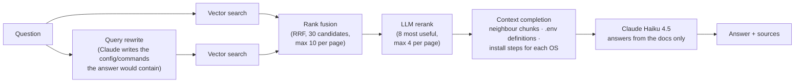

# Document Intelligence Assistant

A RAG (retrieval-augmented generation) assistant that answers DevOps questions from real documentation: Docker, Kubernetes, Azure Pipelines, Google Cloud Run and GitHub incident response. Every answer cites its sources, and when the docs don't cover a question, it says so instead of guessing.

I built it as a portfolio project to learn how to make an LLM application **reliable**, not just working: measure answer quality with an evaluation suite, find out *why* an answer is wrong, and fix the actual cause.

[](https://github.com/Edem94/document-intelligence-assistant/actions/workflows/ci.yml)

**Live demo:** https://document-intelligence-assistant-lji4mh65gq-ew.a.run.app



## What it does

Ask *"How do I define a multi-container app with Docker Compose?"* and you get:

- a complete `compose.yaml` copied word for word from the docs (no invented config)
- a **Requires:** list that names what the example depends on: the `.env` file with its values, the `Dockerfile` behind `build: .`, and the exact run command (`docker compose up --watch` when the example uses Compose Watch)
- the source documents it used

The answer streams in as it's written. Questions outside the docs, like *"How do I configure a Terraform S3 backend?"*, get an honest "I don't have enough information" instead of an answer from the model's general knowledge.

## Results

I evaluate every change against **24 test questions** ([eval/eval_set.json](eval/eval_set.json)) that I wrote and checked against the source docs: 22 answerable ones across all topics, plus 2 out-of-scope traps.

| Metric | First baseline | Now |
|---|---|---|
| Pass rate (all checks) | 90% (18/20) | **95.8% (23/24)** |
| Expected source retrieved | 100% | **100%** |
| Answers with invented code | 1 | **0** |
| Out-of-scope questions refused | 100% | **100%** |
| Faithfulness / completeness (LLM judge, 1–5) | 4.94 / 4.67 | **4.95 / 4.91** |
| Average latency (full answer) | 3.6 s | 6.6 s |

The one remaining failure is a known retrieval issue (see [Limitations](#limitations-and-next-steps)). Latency went up because the pipeline gained a query rewrite and a reranking step; I traded speed for answers that are complete and correct. Answers now stream, so text starts appearing before the full answer is done.

**A pass needs more than an LLM judge's score.** Early on I found the judge giving 5/5 to an answer with fabricated YAML, so pass/fail is decided by deterministic checks:

- **Invented code:** every line in the answer's code blocks must appear in the retrieved docs. Changing only placeholder values in a command (an image tag, a port) is allowed; new flags or edited config are not.
- **Undisclosed setup:** `${VARIABLES}` without saying where they're set, an `include:` file that's never shown, or `develop: watch` without `--watch` all fail.
- **Retrieval hit, required keywords, command order** (install → start → verify), **broken links**, false refusals, and leaking "the context" wording to the user.

## How it works



**Ingestion** ([app/ingest.py](app/ingest.py)) loads HTML, Markdown, PDF and text files, cleans them, splits them into 800-character chunks, embeds them locally with `all-MiniLM-L6-v2`, and stores them in Chroma. The cleaning turned out to matter as much as the model:

- Syntax-highlighted code blocks are kept intact (originally, YAML came out as `services | : | web | :`, one token per line).
- Navigation, tables of contents and buttons are stripped.
- Relative links like `/docs/setup/` are rewritten to the real site, so they don't 404 in the UI.
- Near-empty chunks (a page title plus "Table of contents") are skipped.

**Retrieval** ([app/retrieval.py](app/retrieval.py)), stage by stage:

1. **Query rewrite ("code HyDE")**: a YAML-heavy chunk is a poor match for a plain-English question but a close match for similar YAML. So Claude first writes the snippet the answer would contain, and both the question and the snippet are searched.
2. **Reciprocal Rank Fusion** merges the two result lists, always keeping each query's best hit.
3. **LLM rerank**: embeddings rank "uses the same words" above "actually answers it". A complete two-service Compose file ranked 9th; a reranker picks it reliably.
   Both the 30 candidates and the 8 picks are capped per page (10 and 4), so one long page can't crowd out the rest.
4. **Context completion** (deterministic, no LLM): adds neighbouring chunks (a tutorial step's intro, its YAML and the files it depends on are split across chunks), the chunk that defines each `${VARIABLE}`, and install steps for every OS when a page lists several.

**Generation** ([app/rag_chain.py](app/rag_chain.py)) uses Claude Haiku 4.5 with a prompt that:

- answers the question in the first sentence
- copies examples verbatim from one source
- gives setup procedures as ordered steps (prerequisites → install → run → verify)
- adds a **Requires:** list after every config example

## Tech stack

| Area | Tools |
|---|---|
| LLM | Claude Haiku 4.5 (Anthropic API) via LangChain |
| Retrieval | Chroma, sentence-transformers (`all-MiniLM-L6-v2`), RRF, LLM reranking |
| Backend | FastAPI, Uvicorn, Pydantic; streamed responses (NDJSON); per-IP rate limiting |
| Frontend | Plain HTML/CSS/JS, `marked` + DOMPurify for safe Markdown rendering |
| Evaluation | Custom suite: deterministic checks + LLM-as-judge |
| Testing | pytest (52 tests: API, streaming, rate limiting, loader regression tests) |
| Delivery | Docker (multi-stage, non-root), Docker Compose, GitHub Actions, Google Cloud Run |

## Run it

You need an [Anthropic API key](https://console.anthropic.com/). Put it in a `.env` file in the project root:

```
ANTHROPIC_API_KEY=sk-ant-...
```

### With Docker (easiest)

```bash
docker compose up --build -d
```

Open http://localhost:8000. The first build takes about 12 minutes: it installs CPU-only PyTorch, downloads the embedding model and builds the search index *into the image*, so the container starts ready to answer and never downloads anything at run time.

### Locally with Python 3.13

```bash
python -m venv venv
venv\Scripts\activate            # macOS/Linux: source venv/bin/activate
pip install -r requirements.lock.txt
python -m app.ingest             # build the Chroma index from data/raw_docs
uvicorn app.main:app --reload
```

### Endpoints

| Endpoint | Description |
|---|---|
| `GET /` | Web UI |
| `POST /ask` | `{"question": "..."}` → `{"answer": "...", "sources": [{"file": "...", "page": null}]}` |
| `POST /ask/stream` | Same answer, streamed as one JSON event per line: `sources` first, then `token`s, then `done` (used by the UI) |
| `GET /health` | `200` when ready; `503` with the reason if the index or API key is missing |
| `GET /docs` | Interactive API docs (Swagger) |

Both question endpoints are rate-limited, because every question is a paid API call: 10 per minute and 100 per day per IP, plus 1,000 per day in total (configurable with environment variables). Over the limit, they return `429` with a `Retry-After` header.

## Tests and evaluation

```bash
pip install pytest                 # not in the runtime lock file
python -m pytest tests -v          # 52 tests, no API key needed (the LLM is stubbed)
python -m eval.run_eval            # 24-question eval with LLM judge (~3 min, uses your API key)
python -m eval.run_eval --no-judge --only compose-define-multi docker-write-dockerfile
```

The loader tests are regression tests for bugs I actually hit. To check they work, I temporarily broke each feature in the loader (7 different ways) and confirmed the tests failed every time. I did the same for rate limiting: skipping the check and reading a spoofable IP header are both caught.

## CI/CD

[GitHub Actions](.github/workflows/ci.yml) runs on every pull request:

1. **Unit tests**: the full pytest suite.
2. **Docker build + smoke test**: builds the production image, waits for the container to report healthy, and checks `/health` and the UI.
3. **Deploy** (merges to `main` only, after both checks pass): pushes the image to Artifact Registry and deploys it to Cloud Run. GitHub logs in with Workload Identity Federation, so no cloud credentials are stored in GitHub, and the API key comes from Secret Manager.

## Project structure

```
app/
  main.py        FastAPI app: /ask, /ask/stream, /health, static frontend
  rag_chain.py   prompt + answer generation (whole or streamed)
  retrieval.py   query rewrite, fusion, reranking, context completion
  rate_limit.py  sliding-window rate limiter, proxy-aware client IP
  ingest.py      loading, cleaning, chunking, indexing
  config.py      paths and settings
frontend/        index.html, style.css, app.js
data/raw_docs/   27 source documents (+ sites.json for resolving Markdown links)
eval/            eval_set.json, run_eval.py, results/
tests/           API, streaming, rate limiting and loader tests
Dockerfile       multi-stage production image
compose.yaml     run configuration
```

## What I learned

These are the problems that taught me the most. Each one started as "the answer looks a bit off" and ended with a measurable fix.

- **Most "LLM problems" were retrieval problems.** A Compose answer kept missing its multi-container example. Rewording the prompt didn't help, because the right chunk never reached the model: it ranked 26th. Tracing which chunks reached the model, instead of tweaking the prompt, found the real cause almost every time.
- **Test changes against more than one question.** Contextual chunk headers, a cross-encoder reranker and bigger chunks each looked promising, and each made the target question *worse*. Comparing several approaches on the same questions saved me from shipping a plausible-sounding idea.
- **An LLM judge is not enough.** It rated invented YAML 5/5. Deterministic checks for invented code and undisclosed setup caught what the judge missed.
- **Prompt rules interfere with each other.** Adding a rule for `--watch` made the model drop a different rule. Merging related rules into one ordered checklist, and putting a reminder at the end of the prompt, fixed both. Without the eval suite I wouldn't have noticed.
- **Adding documents can make other answers worse.** New Kubernetes and Docker pages pushed good chunks out of the candidate pool for unrelated questions. Re-running the full eval after every corpus change caught it.
- **Small infrastructure details matter.** A template `.dockerignore` rule (`**/Dockerfile*`) would have silently dropped `Dockerfile_overview.html` from the index inside the container. Relative links from the docs pointed at my own server and returned 404s.
- **One long page can crowd out the answer, but a cap can backfire.** For "How do I restart a Pod?", two long pages filled 25 of the 30 candidates, so the key note ("a Pod persists until it is deleted") ranked 16th, just outside the cut-off. Capping chunks per page in the candidate pool got it into the answer. Capping the reranker's *picks* per page as well looked like the next step, but it cut the build commands out of the Dockerfile answer. Comparing four settings on what each answer's context actually contained showed the real fix was more picks (10 instead of 8), not a cap.
- **Don't trust the client's view of its own IP.** Behind Cloud Run's proxy, every request seems to come from the proxy's IP. The real client IP is in `X-Forwarded-For`, but only the entry the trusted proxy appended is reliable: uvicorn's `--forwarded-allow-ips="*"` reads the first entry, which clients can fake. I verified the fix on the live service with spoofed headers and Cloud Run logs.

## Limitations and next steps

- **One eval case still fails:** "How do I restart a Kubernetes pod?" The answer now explains that a Pod isn't restarted but persists until deleted, but it misses the practical next step: a controller (e.g. a Deployment) creates a replacement. The docs say that in words like "replacement Pods" and "pod template", which the small embedding model doesn't connect to "restart". Those chunks rank 43rd or lower, and an explanation-style search query didn't rank them any better. Next step: a stronger embedding model, measured with the same eval.
- **A small, self-written eval set.** 24 cases is enough to catch regressions, not to prove general quality. I'd like to grow it and add questions written by other people.
- **The first words take a few seconds.** The answer streams as it's written, but query rewriting and reranking (two extra LLM calls) run before it starts.
- **Rate limits are per instance.** They're kept in memory, so with up to 2 Cloud Run instances a client could get up to 2× the limits; shared limits would need Redis or Cloud Armor.
- **The image is large** (~600 MB compressed), mostly PyTorch for a small embedding model. An ONNX-based embedder could shrink it a lot.
